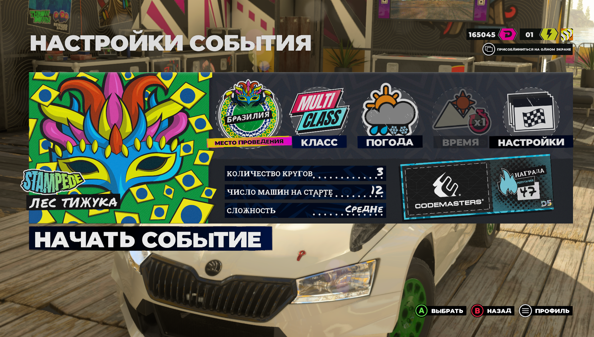

# DIRT 5 — Русификатор

Полная русская текстовая локализация DIRT 5 для ПК с оригинальной английской озвучкой.

## О русификаторе

- 6 473 переведённые строки.
- Русский интерфейс и субтитры.
- Оригинальная английская озвучка.
- Адаптированные шрифты.
- Сохранение оригинальных языков.

## Установка

1. Скачайте и распакуйте архив.
2. Запустите `Install_RU.bat`.
3. Укажите папку игры и нажмите «Установить».
4. Запустите игру через ярлык «DIRT 5 — Русская версия».

## Удаление

1. Закройте игру.
2. Запустите `Uninstall_RU.bat`.
3. Укажите папку игры и нажмите «Удалить».

Оригинальные файлы восстановятся автоматически.
